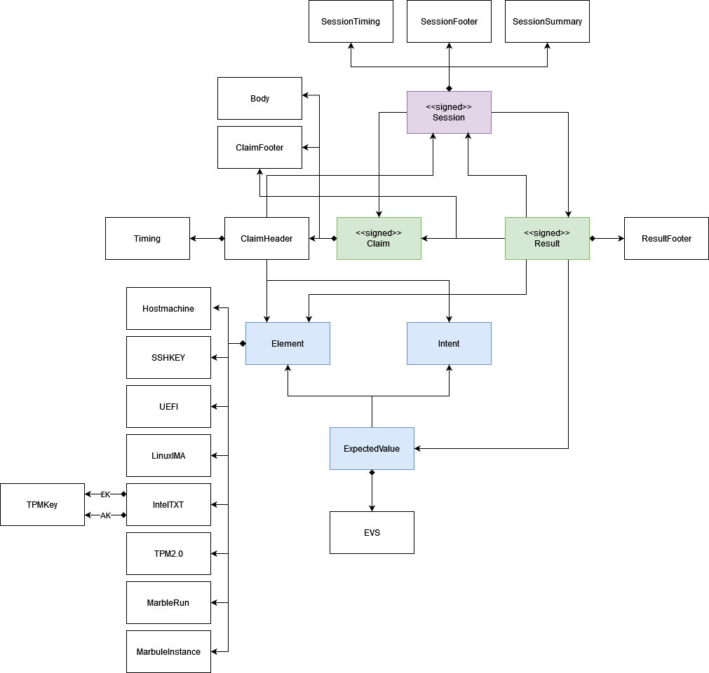

# Data Models

The internal data model linking elemenets, intents, expected values, claims, results and sessions is presented below.

A newer diagram of the data model, with a short explanation, is on the [Architecture](architecture.md) page.
